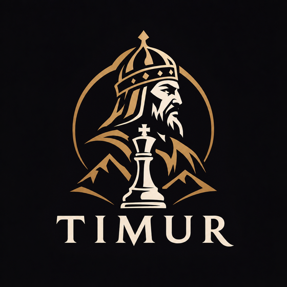

<p align="center">
  
</p>

# Timur

A chess trainer that runs entirely on your Mac. Stockfish 19 analyses your games and positions, the Syzygy tablebases judge endgames exactly, and everything you save stays in one local database file. Nothing is sent anywhere unless you turn on downloading opponents' games.

It is built for a tournament player who wants to:

- analyse any position with a strong engine,
- see which moves in a game were good and which were mistakes, and why,
- keep games and analyses organised by opening and date,
- write notes tied to positions, games and tournaments,
- learn the endgames that decide results,
- practise against the engine, solve their own mistakes and drill an opening repertoire,
- prepare for a tournament round by round.

---

## Contents

- [Requirements](#requirements)
- [Install and run](#install-and-run)
- [First start](#first-start)
- [What each page does](#what-each-page-does)
- [Common tasks](#common-tasks)
- [Keyboard shortcuts](#keyboard-shortcuts)
- [Your data, backups and privacy](#your-data-backups-and-privacy)
- [Settings and start options](#settings-and-start-options)
- [Troubleshooting](#troubleshooting)
- [How it works](#how-it-works)
- [Project layout](#project-layout)
- [Development](#development)
- [Tests](#tests)
- [Credits and licences](#credits-and-licences)

---

## Requirements

| Needed | Install with | Why |
|---|---|---|
| macOS (Apple silicon or Intel) | | Tested on a 12-core Mac. Linux works with the same steps. |
| Stockfish | `brew install stockfish` | The chess engine |
| Python 3.11 or newer | `brew install python` | Runs the server |
| Node.js 20 or newer | `brew install node` | Builds the web interface |
| About 1.2 GB of disk space | | Mostly the endgame tablebases |

If you don't have Homebrew, see https://brew.sh.

## Install and run

The project lives in the `timur` folder. Open Terminal and run:

```bash
cd ~/Desktop/timur
```

```bash
./start.sh
```

The first start takes about a minute. It creates a Python environment, installs the packages and builds the web interface. Later starts take a few seconds.

It also starts [Ollama](https://ollama.com) for the AI coach if it isn't running yet, and loads the coach's model in the background so the first answer is quick. If Ollama or the model is missing, it says how to install it, and the rest of Timur works as usual.

Timur opens in your browser on the analysis board, with the AI coach, at **http://127.0.0.1:8000/#/analysis**. Keep the Terminal window open while you use it. Press **Ctrl+C** in Terminal to stop it.

### Endgame tablebases (recommended, about 1 GB)

The endgame trainer works without them by using Stockfish, but with them every move in a position with 5 pieces or fewer is judged exactly. To download them:

```bash
./scripts/get-tablebases.sh
```

The script fetches the 290 Syzygy 3-4-5 piece files from lichess's mirror over HTTPS and checks each one against the published SHA-256 checksums. It skips files it already has, so you can run it again if it stops halfway. Restart Timur afterwards, or press "Check again" under Settings.

## First start

A welcome screen asks for the name you play under. Enter it as it appears in your PGN files (for example your name, or your lichess or Chess.com username). Separate several names with commas. Timur uses these names to tell which side you played in imported games, so your scores, puzzles and statistics are about your moves. You can change them later in Settings.

A good first hour:

1. Paste one of your recent games under **Game review** and start a review.
2. While it runs, open the **Endgames** page and try "Queen and king against king".
3. Open the finished review, step through your mistakes with N and P, and use "Retry this move".
4. Look at the game in the **Library**, then try the puzzles made from your mistakes under **Practice**.

---

## What each page does

### Analysis board

- Live Stockfish analysis with 1 to 5 lines, an evaluation bar and arrows for the best moves.
- Play any move to start a side line. Side lines can be promoted to the main line or deleted.
- Click a move in an engine line to play the line up to that move.
- Threat mode (X) shows what the opponent is threatening if it were their move.
- Import PGN or FEN, set up a position by hand, and copy the PGN or FEN.
- The opening name (ECO code and name) is shown above the board.
- **Save** (in the board toolbar, or **Save this analysis** in the Saved column) asks for a name and stores the board in the library, side lines and comments included. The name is kept in the PGN's Event header. From then on every change is saved automatically ("Saved to library" next to the opening name). Click **Saved** or **Rename this analysis** to change the name.
- **Saved**, the column left of the board, lists your saved analyses, newest first. Search them by name or opening, switch to **All games** to see the whole library, click one to open it on the board (at its last move), or delete it with the bin icon. The arrow at the top folds the column into a thin strip to give the board more room; Timur remembers your choice.
- **Notes on this position** lists your notes for the exact position on the board and lets you add one. The first line becomes the title. ⌘ Enter saves.
- **AI coach** (its own column at the right; the arrow in its header folds it to a slim rail, the ✦ button opens it again. Below 1400 px wide it sits under the board, and between 1400 and 1800 px it takes turns with the Saved column) is a chat with the local model about the position on the board. Before each answer, Stockfish analyses the position (top 3 lines and the threat), checks any move you name in your question ("What about Nxe5?"), and python-chess lists the position's features. The model answers from those facts. Moves in an answer that Stockfish didn't look at are flagged, and **Facts from Stockfish and the board** under each answer shows what it was told. The chat stays while you move around the board; each question is tagged with the position it was asked about. Uses the same model and settings as Game review's AI explanations.
- **Review this game** sends the main line to Game review.

### Game review

- Paste a PGN, open a .pgn file, or send a game from the analysis board.
- Choose your colour and the depth: Quick (depth 14), Standard (depth 18) or Deep (depth 22).
- Every move is labelled best, excellent, good, inaccuracy, mistake or blunder. Labels come from how much a move lowers the mover's chance of winning, using the same cut-offs as lichess (5, 10 and 15 percentage points). You can change them in Settings.
- You get accuracy for each side, an evaluation graph, a plain-language reason for each mistake (for example a hanging piece or an allowed fork) and the best line.
- **Retry this move** lets you look for the better move yourself before seeing the answer.
- **Explain with AI** (optional) has a local model write a short explanation for an inaccuracy, mistake or blunder. The model doesn't judge the chess. Stockfish supplies the best line, the refutation, the other good moves and any threat you missed, and python-chess lists what each line changes in the position (backward or isolated pawns, outposts, king cover, loose pieces, material). The model only puts those facts into words. Every move it mentions is checked against the engine's lines; if it names one that isn't there, it is asked to rewrite, and if it still fails, the built-in hint is shown instead. Open **Facts the coach was given** to see exactly what it was told. Explanations are saved with the review. This needs [Ollama](https://ollama.com) running with the model installed (`ollama pull gemma4:12b-mlx`); you can change the model or server, or turn this off, in Settings → AI coach.
- Reviews run in the background on their own Stockfish process, so the analysis board stays fast. Unfinished reviews start again after a restart.
- Every reviewed game is filed in the library.

### Library

- Every game and analysis you saved, reviewed, imported or played in practice, grouped by month.
- An opening tree on the left: opening families, then their variations, with how many games you have in each.
- Pick an opening to see your score with White and with Black, your average accuracy in reviewed games, and the move number where your mistakes cluster.
- Filter by search text, colour, result, games or analyses, and dates.
- Click a game to open it on the analysis board. Changes you make there are saved back to the library.
- **Add games** imports one game or a whole PGN file. Games already in the library are skipped, so importing the same file twice is safe.
- **Export PGN** downloads the games that match the current filters.

Openings are recognised by position, not by move order, so a game that transposes into a known opening gets that opening's name.

### Notes

- Notes are written in Markdown (headings, lists, bold, quotes). Switch between Write and Read.
- Tags, pinning and full-text search. The search matches word beginnings, so "najd" finds "Najdorf".
- A note can be tied to a position (with a small board and an "Open on board" button), an opening, a library game or a tournament.
- Notes save as you type.
- **Export** downloads all notes as a .zip of Markdown files, or writes them to `data/notes-export/`. They open in any Markdown editor (Obsidian, iA Writer, VS Code).

### Endgames

20 lessons in five groups:

| Group | Lessons |
|---|---|
| Basic mates | Queen, rook, two bishops, bishop and knight, mate without stalemate |
| King and pawn | Key squares, opposition, rule of the square, Réti's king walk, rook pawn, outside passed pawn |
| Rook endings | Lucena, Philidor, cutting the king off, Vancura, rook against a far-advanced pawn |
| Minor pieces | Wrong bishop, opposite-coloured bishops |
| Queen endings | Queen against a d-pawn on the 7th, queen against a c-pawn (stalemate trick) |

- Each lesson explains the idea in a few steps, then you play it against a defender that makes the most stubborn moves.
- Your goal is shown: deliver mate, promote, win the pawns, or keep the win or the draw for a number of moves.
- A move that throws away the result ends the attempt and shows the right move. You can try that move again or restart.
- **Hint** shows a good move and a sample line.
- **From your games**: endgames where you made a mistake or blunder in a reviewed game become drills. The goal is the result the position deserved.
- Solved lessons come back on a spaced-repetition schedule: after 1 day, then 3, then less and less often. Solving with a hint or after a failed attempt brings them back sooner. A lesson counts as mastered when it is scheduled three weeks or more ahead.

### Practice

**Play the engine**
- Choose your colour and a strength: about 1350, 1600, 1850, 2100 or 2400, or full strength. Strength uses Stockfish's own rating limiter.
- Start from the initial position or from the position on the analysis board.
- When the game ends, review it or just save it to the library.

**Puzzles from your games**
- Every mistake and blunder you made in a reviewed game becomes a puzzle: find a better move than the one you played.
- Your move counts if it is the engine's move or keeps nearly the same winning chance (within 5 points).
- Filter to endgame positions only. Puzzles you haven't tried and ones that are due come first.

**Opening repertoire**
- Separate repertoires for White and Black.
- **Build**: play moves on the board. Your own move in each position, plus the opponent replies you want to be ready for. Arrows show what is already saved. Import a PGN with variations to add many lines at once (up to move 15), or copy the repertoire as PGN.
- **Train**: Timur plays the opponent's moves from your repertoire at random and you answer with your prepared move. Mistakes are shown at once and the move comes back sooner.

### Tournament prep

- Tournaments with dates, location, time control and a checklist (a starter list is filled in).
- Rounds: opponent, rating, your colour, result, what you expect them to play, your preparation, and a link to the game. The current score is shown at the top.
- Notes for the tournament, created from its page.
- **Opponents**: download a player's public games from lichess or Chess.com (only when "Allow internet" is on in Settings). Each opponent gets a page showing which openings they play with White and with Black, how often, and how they score. Games of players already in your library show up there too.

### Settings

- Your names as they appear in PGN files.
- Theme: same as macOS, dark or light.
- Default review depth and the thresholds for inaccuracy, mistake and blunder.
- Engine: Stockfish location, threads and hash for the analysis board and for reviews. Changes apply right away.
- Tablebase status.
- The "Allow internet" switch (off by default).
- Backups: make one now, download, restore from the list or from a file, delete.

---

## Common tasks

**Save an analysis.** Analysis board → Save to library. Later changes save automatically. Find it again under Library.

**Review a game you played.** Game review → paste the PGN → choose your colour → Start review. Or open the game on the analysis board and press Review this game.

**Import your games.** Library → Add games → paste or open a .pgn file. Set your names in Settings first so Timur knows your colour in each game.

**Find your weak openings.** Library → click an opening family in the tree. The panel shows your score per colour and where your mistakes happen.

**Prepare for a round.** Tournament prep → open the tournament → Add round → enter the opponent → Prepare. Use "What does … play?" to see their openings, then drill your answer under Practice → Opening repertoire.

**Keep notes on a line.** Go to the position on the analysis board and write in "Notes on this position". The note appears whenever you reach that position again, from any game.

---

## Keyboard shortcuts

| Key | Analysis board | Game review |
|---|---|---|
| ← → | Previous and next move | Previous and next move |
| ↑ ↓ | Start and end of the line | Start and end of the game |
| Home End | | Start and end of the game |
| Space | Engine on or off | |
| F | Flip the board | Flip the board |
| X | Threat mode | |
| N P | | Next and previous mistake |
| ⌘ Enter | Save a position note | |

Shortcuts are ignored while you type in a text field.

---

## Your data, backups and privacy

Everything lives in the `data` folder next to the app:

| Path | What |
|---|---|
| `data/timur.db` | Games, reviews, notes, training progress, repertoire, tournaments and settings (SQLite) |
| `data/backups/` | Backups. One is made automatically each day Timur starts; the newest 30 are kept. |
| `data/syzygy/` | Endgame tablebases |
| `data/notes-export/` | Notes exported as Markdown files, when you choose that |

- **Backups**: Settings → Backups. "Back up now" makes a consistent copy even while Timur is running. Before any restore, Timur makes a safety backup of the current data, so a restore can always be undone.
- **Moving to another Mac**: copy the `data` folder, or download a backup and use "Restore from a file" on the other Mac.
- **Privacy**: the server only listens on 127.0.0.1, so other devices on your network can't reach it. Timur makes no network requests except when you download an opponent's games with "Allow internet" on. Then only the username you look up is sent to lichess or Chess.com.

---

## Settings and start options

Most settings are on the Settings page. A few can also be given when starting, which is handy for testing:

| Variable | Default | Meaning |
|---|---|---|
| `PORT` | 8000 | Port of the web interface |
| `STOCKFISH_PATH` | found automatically | Path to a specific Stockfish program |
| `TIMUR_DATA_DIR` | `./data` | Where the database, backups and tablebases are |
| `TIMUR_NO_BROWSER` | | Set to 1 to not open the browser |
| `TIMUR_NO_AI` | | Set to 1 to not start Ollama or load the AI coach's model |
| `TIMUR_LIVE_THREADS`, `TIMUR_LIVE_HASH_MB` | cores minus 4, 1024 | Analysis board engine |
| `TIMUR_REVIEW_THREADS`, `TIMUR_REVIEW_HASH_MB` | up to 4, 256 | Game review engine |

Example:

```bash
PORT=8010 TIMUR_LIVE_THREADS=6 ./start.sh
```

Engine values saved on the Settings page take precedence over these.

---

## Troubleshooting

| Problem | What to do |
|---|---|
| "Stockfish is not installed" | `brew install stockfish`, or set `STOCKFISH_PATH`, or enter the path under Settings → Engine. |
| "Port 8000 is already in use" | Timur is probably already running in another Terminal window. Use that one, or start with `PORT=8010 ./start.sh`. |
| The sidebar says "Server offline" | The Terminal window running `./start.sh` was closed or stopped. Start it again; the page reconnects by itself. |
| The endgame page says the tablebases are not installed | Run `./scripts/get-tablebases.sh`, then press "Check again" under Settings. |
| Imported games don't know which side you played | Add your names under Settings, or choose "White in every game" or "Black in every game" when importing. |
| Downloading an opponent's games says Timur works offline | Turn on "Allow internet" under Settings. |
| Something looks broken after an update | Stop Timur and start it again. `./start.sh` rebuilds the interface when its files changed. |

---

## How it works

```
Browser (React)  ──HTTP + WebSocket──▶  FastAPI server on 127.0.0.1  ──UCI──▶  Stockfish processes
                                              │                                   (live, review, trainer)
                                              ├── SQLite: data/timur.db
                                              ├── Syzygy tablebases: data/syzygy
                                              └── Opening list: backend/app/data/openings
```

- **Three Stockfish processes.** The analysis board, the review queue and the trainer (endgames, puzzles, play) each have their own engine, so a long review never slows down the board. The board gets most of the CPU.
- **Live analysis** streams over a WebSocket. A new position replaces the old search at once.
- **Evaluations** are stored from White's point of view and turned into a winning chance with lichess's formula. Move labels and accuracy use that winning chance, which is why losing two pawns in a completely won position counts less than the same loss in an equal one.
- **Endgames**: with 5 pieces or fewer the trainer asks the tablebases for the exact result of every move. The defender plays the move that holds out longest. Stockfish also uses the tablebases in its own search. With more pieces, Stockfish's evaluation decides.
- **Openings** come from lichess's chess-openings list (about 3,800 named positions) and are matched by position, so transpositions are named correctly. The deepest named position reached in the game wins.
- **Notes search** uses SQLite's built-in full-text index.
- **Spaced repetition** is a simple version of the SM-2 method used by flash-card apps.
- **Schema changes** are numbered migrations applied when the app starts, so your database upgrades by itself.

---

## Project layout

```
timur/
├── start.sh                 start the app (or ./start.sh dev)
├── test.sh                  run the tests
├── scripts/
│   └── get-tablebases.sh    download the Syzygy 3-4-5 tablebases
├── data/                    your data (database, backups, tablebases)
├── backend/                 Python server
│   ├── app/
│   │   ├── main.py          app, health, live engine, PGN and review routes
│   │   ├── context.py       shared objects: database, settings, engines, tablebases
│   │   ├── config.py        defaults and environment variables
│   │   ├── db.py            SQLite access and migrations
│   │   ├── engine.py        Stockfish processes and live analysis
│   │   ├── evals.py         evaluation and winning-chance helpers
│   │   ├── pgn_tools.py     PGN reading
│   │   ├── openings.py      opening names
│   │   ├── library.py       games library, opening tree and statistics
│   │   ├── tablebase.py     Syzygy probing
│   │   ├── trainer.py       judging positions and playing the other side
│   │   ├── training.py      spaced repetition
│   │   ├── drills.py        puzzles and endgame drills from your reviews
│   │   ├── settings_store.py  saved settings
│   │   ├── review/          review queue, move labels, plain-language explanations
│   │   ├── routes/          library, notes, endgames, practice, prep, settings and backups
│   │   └── data/            opening list and endgame lessons (lessons.json)
│   └── tests/               pytest tests
└── frontend/                web interface (React, TypeScript, Vite)
    └── src/
        ├── pages/           one file per page
        ├── components/      board, eval bar, scoresheet, dialogs, ...
        ├── state/           stores for the board, engine, health and theme
        ├── lib/             API client, chess helpers, move tree and PGN export
        ├── hooks/
        └── styles/app.css
```

Main libraries: [FastAPI](https://fastapi.tiangolo.com), [python-chess](https://python-chess.readthedocs.io), [React](https://react.dev), [chessground](https://github.com/lichess-org/chessground) (lichess's board), [chess.js](https://github.com/jhlywa/chess.js), [zustand](https://github.com/pmndrs/zustand), and [marked](https://marked.js.org) with [DOMPurify](https://github.com/cure53/DOMPurify) for notes.

---

## Development

```bash
./start.sh dev
```

This runs the server on port 8000 with auto-reload, and the interface on **http://127.0.0.1:5173**, which reloads when you save a file.

Type check and production build, from `frontend/`:

```bash
npm run typecheck
```

```bash
npm run build
```

To add an endgame lesson, add an entry to `backend/app/data/endgames/lessons.json` with a FEN (the side to move is the side you play), a goal (`win` or `draw`) and a success rule (`mate`, `promote`, `capture`, or `hold` with a number of moves). Check the goal against the tablebase before relying on it.

---

## Tests

```bash
./test.sh
```

This runs the Python tests, then a type check and the web interface tests. The first run installs the test packages. It takes about 15 seconds.

| Command | Runs |
|---|---|
| `./test.sh backend` | Python only |
| `./test.sh frontend` | Type check and web interface only |
| `./test.sh backend -k review` | Anything after the first word goes to pytest or vitest |

- The Python tests run against the real Stockfish with small settings so they stay quick. Without Stockfish they are skipped.
- Tests never touch `data/timur.db`: they use a temporary folder that is deleted afterwards.
- The review page tests use a real review saved in `frontend/src/test/fixtures/scholars-mate-review.json`.

Coverage today: the foundations, the analysis board and game review are tested (424 tests). The library, notes, endgames, practice, tournament prep and settings don't have tests yet.

---

## Credits and licences

- [Stockfish](https://stockfishchess.org) (GPL-3.0), the engine. Installed separately, not included.
- [Syzygy tablebases](https://github.com/syzygy1/tb) by Ronald de Man, downloaded from lichess's mirror.
- [lichess-org/chess-openings](https://github.com/lichess-org/chess-openings) (CC0), the opening names in `backend/app/data/openings`.
- [python-chess](https://github.com/niklasf/python-chess) (GPL-3.0) and [chessground](https://github.com/lichess-org/chessground) (GPL-3.0).
- The winning-chance formula and mistake thresholds follow [lichess](https://lichess.org).
- Fonts: Atkinson Hyperlegible Next and Archivo, both under the SIL Open Font License.

Because Timur uses GPL libraries, you would need to share it under GPL-3.0 if you distribute it. For personal use on your own computer there is nothing to do.
